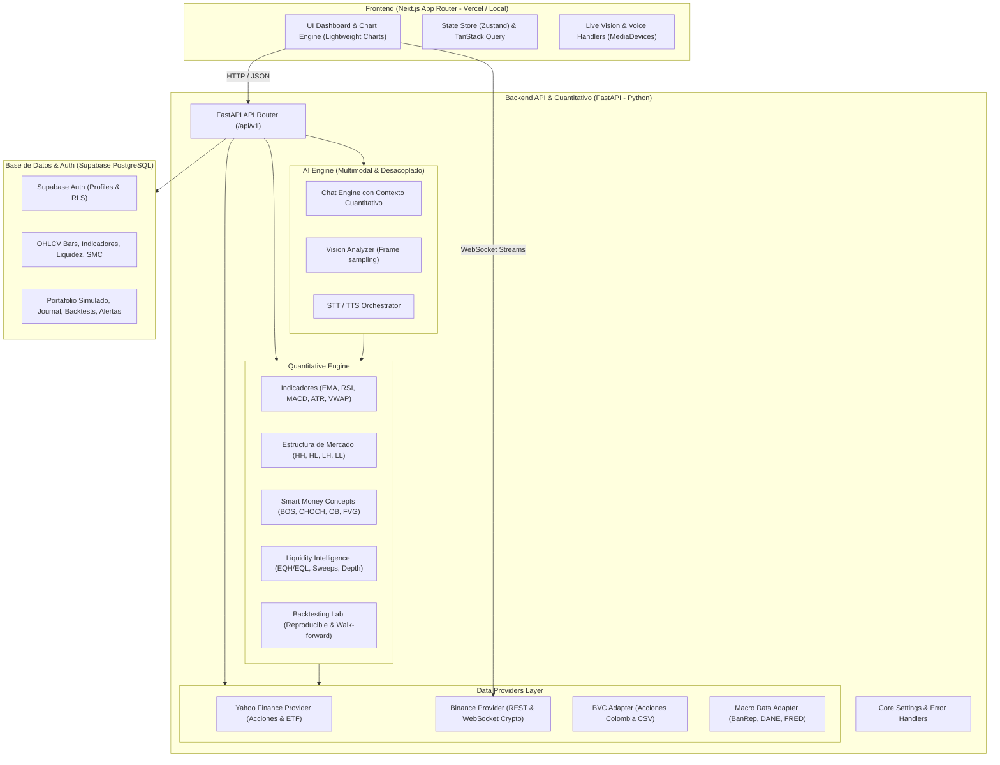

# QUANT AI — Arquitectura Técnica de la Plataforma

## 1. Visión General del Sistema
QUANT AI es una plataforma modular de nivel profesional diseñada para la investigación cuantitativa, análisis técnico y conceptual de swing trading (Price Action & Smart Money Concepts), inteligencia de liquidez, y asistencia interactiva multimodal (IA de texto, visión sobre pantalla y voz).

El sistema sigue un patrón de **monolito modular** en un **monorepositorio**:
- **Frontend desacoplado:** Next.js (App Router, React 18, TypeScript, Tailwind CSS, Lightweight Charts, Zustand, TanStack Query).
- **Backend cuantitativo de alto rendimiento:** Python (FastAPI, Pandas, NumPy, SciPy, scikit-learn) ejecutado con `uv`.
- **Capa de tiempo real:** WebSockets directos para streams de Binance, SSE para actualizaciones de mercado, y WebRTC/MediaStream para visión y voz.
- **Base de datos & Auth:** Supabase PostgreSQL con Row Level Security (RLS) en 22 entidades de dominio.

---

## 2. Diagrama de Arquitectura de Componentes

---

## 3. Modelo de Datos (Supabase PostgreSQL)
El esquema comprende **22 tablas relacionales** con políticas estrictas de aislamiento multinquilino (RLS):

1. `profiles`: Perfil del usuario, moneda preferida (`COP`), zona horaria (`America/Bogota`).
2. `user_permissions`: Roles y permisos para uso de IA, visión, voz y simulaciones.
3. `user_voice_preferences`: Parámetros de síntesis y reconocimiento de voz (tasa, pitch, acento).
4. `data_sources`: Registro de proveedores (`yahoo`, `binance`, `bvc`, `banrep`, `fred`) con latencia y estado.
5. `instruments`: Catálogo unificado de activos (Acciones US, ETFs, Cripto, Acciones BVC).
6. `ohlcv_bars`: Serie histórica normalizada con constraint único `(symbol, interval, timestamp)`.
7. `indicator_values`: Almacén de indicadores técnicos precalculados en JSONB.
8. `market_structures`: Registro de pivotes Swing High/Low y rupturas estructurales.
9. `smc_zones`: Zonas SMC identificadas (BOS, CHOCH, Order Blocks, FVGs, Mitigación).
10. `liquidity_zones`: Zonas de liquidez técnica (EQH, EQL, BSL, SSL, PDDH, PDDL) con score de liquidez.
11. `order_book_snapshots`: Instantáneas de profundidad de libro y desequilibrio bid/ask.
12. `watchlists`: Listas de seguimiento personalizadas por usuario.
13. `scanner_results`: Resultados de barridos algorítmicos con evidencia y criterios evaluados.
14. `strategies`: Definición formal de reglas de swing trading y parámetros de riesgo.
15. `backtest_runs`: Ejecuciones de simulaciones cuantitativas con Sharpe, Sortino, Max Drawdown y CAGR.
16. `backtest_trades`: Detalle trade por trade con PnL, slippage y comisiones modeladas.
17. `simulated_portfolios`: Portafolios educativos en pesos colombianos (`COP`) sin ejecución real.
18. `journal_entries`: Diario de trading con hipótesis, evidencia, reglas e invalidaciones.
19. `alerts`: Alertas técnicas y conceptuales activables por condiciones de mercado.
20. `chat_sessions`: Sesiones del analista cuántico contextual.
21. `chat_messages`: Mensajes vinculados con snapshot de contexto de mercado.
22. `ai_reports`: Informes auditables generados por la IA distinguiendo hechos de hipótesis.
